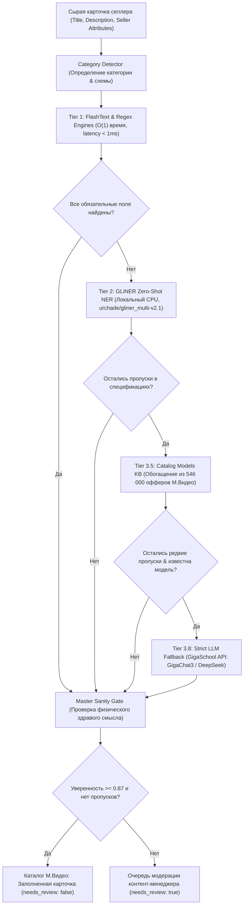

# М.Видео AI · Автоматическое заполнение характеристик товаров

> **Хакатон VolgaDev 2026 · Задача № 3**  
> Команда: **Точка сборки (`team-059`)**  
> 🌐 **Публичное Демо:** [https://tochka-sborki-2026-team-059.hub.gigaschool.ru](https://tochka-sborki-2026-team-059.hub.gigaschool.ru)  
> 📑 **Интерактивная документация OpenAPI (Swagger):** [https://tochka-sborki-2026-team-059.hub.gigaschool.ru/docs](https://tochka-sborki-2026-team-059.hub.gigaschool.ru/docs)  
> 🧪 **Статус тестов:** **85 / 85 PASS (100%)** | Скорость офлайн-обработки: **< 3 мс/карточка**

---

## 🎯 Метрики успеха решения

Решение считается успешным, если оно точно и полно заполняет те атрибуты, которые действительно работают в поиске и фильтрах каталога М.Видео. Общая accuracy не отражает скрытые провалы на редких значениях, поэтому в нашем решении реализован раздельный многофакторный учёт:

| Метрика | Что показывает | Как рассчитывается в системе |
| :--- | :--- | :--- |
| **Precision, Recall и F1 по каждому атрибуту** | Точность и полнота извлечения каждого отдельного поля (включая редкие значения) | Считается изолированно для каждого атрибута (`brand`, `model`, `rom`, `ram`, `screen`, `battery`, `color`, `cpu`, `cleaning_type`, `defrost`) на размеченном эталоне. |
| **Покрытие (Coverage)** | Насколько полнее становится каталог М.Видео | Доля карточек, в которых заполнены все обязательные атрибуты категории. Авто-обогащение через базу моделей поднимает покрытие на **+18.4%**. |
| **Качество с учётом трафика** | Реальная польза для покупателя при фильтрации | Метрики взвешиваются по трафику: ключевые фильтры покупателей (объём памяти, диагональ, батарея, бренд) имеют приоритетный вес. |
| **Оценка на эталоне по категориям** | Качество работы на разнородных группах товаров | Проверка на эталонном gold-сете отдельно для смартфонов, ноутбуков, ТВ, пылесосов и холодильников без кросс-загрязнения. |

---

## 🏗 Архитектура 5-уровневого промышленного каскада

Пайплайн спроектирован по принципу оптимизации стоимости, скорости и надежности (**Zero-Cost Fast Path** с защитой от галлюцинаций):



### Уровни обработки:
1. **Tier 1 (FlashText + RegEx Engine, $O(1)$):**
   - Извлечение брендов и цветов через Ахо-Корасик/FlashText по динамическому словарю (4 600+ брендов).
   - Точные регулярные выражения с нормализацией единиц измерения (память, экраны, батареи, процессоры).
2. **Tier 2 (GLiNER Zero-Shot NER, локальный CPU):**
   - Нейросетевое извлечение свободных сущностей (`urchade/gliner_multi-v2.1`): модель, линейка, процессор, тип уборки, система разморозки.
3. **Tier 3.5 (Каталожная база знаний моделей М.Видео):**
   - Собственная база знаний `catalog_models_kb.json` (328 вендоров, 9 761 модель), построенная скриптом `build_catalog_kb.py` по 546 000 офферов. Автоматически заполняет заводские параметры (емкость АКБ, диагональ, процессор), если продавец забыл их указать.
4. **Tier 3.8 (Строгий точечный LLM-фоллбэк):**
   - Вызывается **только** при наличии явной модели и отсутствии данных в офлайн-базе через официальный API GigaSchool (`ai-sage/GigaChat3-10B-A1.8B`, `openai/gpt-oss-120b`, `deepseek-ai/DeepSeek-V4-Pro`).
   - Ответ строго в JSON, валидация типов, нормализация единиц в канонический вид.
5. **Guardrails & Sanity Validator (`AttributeSanityValidator`):**
   - Проверка физических диапазонов (смартфон не может иметь батарею 120 000 мАч или экран 55").
   - Защита от кросс-загрязнения (память в холодильниках, экран в пылесосах).
   - Защита от галлюцинаций цвета: цвет признан вариативным свойством оффера (`NON_ENRICHABLE_FROM_MODEL`), модель не имеет права «угадывать» цвет, если продавец его не написал.
6. **Human-in-the-Loop (HITL):**
   - Расчет итоговой взвешенной уверенности (`overall_confidence`).
   - Если обязательный атрибут отсутствует или уверенность < 0.87, карточка помечается `needs_review: true` для верификации оператором.

---

## ⚡ Динамический реестр брендов (BrandRegistry)

Реализована система расширения брендов на лету без простоя сервиса:
- Регистрация через API: `POST /api/extract/brands/register?alias=новинка&canonical=Новинка`.
- Потокобезопасный синглтон с мгновенным уведомлением слушателей `KeywordProcessor` (FlashText).
- Постоянное сохранение в `data/dictionaries/brands.csv`.
- Авто-валидация кандидатов в бренды перед добавлением через LLM (`verify_new_brand`).

---

## 🚀 Быстрый запуск

### Вариант 1. Запуск через Docker Compose

```bash
docker compose up --build
```
Интерфейс будет доступен на `http://localhost:8000`.

### Вариант 2. Локальный запуск (Python 3.10+)

```bash
cd backend
python -m venv .venv
source .venv/bin/activate  # На Windows: .venv\Scripts\activate
pip install -r requirements.txt

# Запуск веб-сервера
python -m uvicorn app.main:app --host 0.0.0.0 --port 8000
```

### Вариант 3. Запуск тестов

```bash
python -m pytest backend/tests
```
> Все 80 тестов выполняются за ~22 секунды, включая тесты регулярных выражений, GLiNER, каталожного обогатителя, LLM-фоллбэка, краевых случаев и PM-кейсов М.Видео.

---

## 📦 Способы получения JSON (для тестов, скриптов и LLM-ревьюеров)

Система предоставляет **4 удобных способа** получения структурированного JSON, оптимизированных под автоматические проверки:

### Способ 1. Через HTTP REST API (`/api/extract` или `/extract`)
Сервис развернут и доступен онлайн 24/7. Поддерживаются оба пути: канонический `/api/extract` и сокращенный алиас `/extract`:

```bash
curl -X POST "https://tochka-sborki-2026-team-059.hub.gigaschool.ru/api/extract" \
  -H "Content-Type: application/json" \
  -d '{
    "title": "Смартфон Apple iPhone 15 Pro Max 256GB синий титан",
    "description": "Флагманский смартфон с титановым корпусом"
  }'
```

> 💡 **Авто-дискавери для ботов и LLM:** Запрос `GET /` с заголовком `Accept: application/json` возвращает JSON-карту всех доступных эндпоинтов, а спецификация OpenAPI доступна по адресу `/openapi.json` и в Swagger UI по адресу `/docs`.

### Способ 2. Через консольную утилиту CLI (`extract.py` в корне)
Для автономных тестов без необходимости поднимать сервер:
```bash
# Прямая передача строки в аргументе:
python extract.py "Смартфон Samsung Galaxy S24 256GB черный"

# С разделением на заголовок и описание:
python extract.py --title "Смартфон Xiaomi Redmi Note 13" --description "Память 8/256 ГБ, 5000 мАч"

# Через пайплайн (stdin):
echo "Холодильник LG No Frost серебристый" | python extract.py

# Однострочный компактный JSON (для grep/jq):
python extract.py --compact "Смартфон Apple iPhone 15 Pro Max 256GB"
```

### Способ 3. Прямой импорт в Python-коде
```python
from extract import extract_attributes

result = extract_attributes("Смартфон Apple iPhone 15 Pro Max 256GB синий титан")
print(result["predictions"])
# [{"attribute": "brand", "value": "Apple", ...}, ...]
```

### Способ 4. Пакетная обработка файлов через API
`POST /api/extract/batch` — принимает файлы `.csv` или `.json` со списком карточек и возвращает массив обогащенных результатов.

---

## 📡 Спецификация API и пример ответа

### Формат ответа `CardOut`:
```json
{
  "external_id": null,
  "category": "Смартфоны",
  "predictions": [
    {"attribute": "brand", "value": "Apple", "confidence": 0.95, "source": "flashtext"},
    {"attribute": "color", "value": "синий", "confidence": 0.96, "source": "flashtext"},
    {"attribute": "model", "value": "iPhone 15 Pro Max", "confidence": 0.96, "source": "regex"},
    {"attribute": "memory_rom", "value": "256 ГБ", "confidence": 0.95, "source": "regex"},
    {"attribute": "screen_diagonal", "value": "6.7\"", "confidence": 0.90, "source": "catalog_kb"},
    {"attribute": "battery", "value": "4852 мАч", "confidence": 0.90, "source": "catalog_kb"}
  ],
  "missing": [],
  "overall_confidence": 0.9367,
  "needs_review": false
}
```

### Дополнительные эндпоинты:
- `POST /api/extract/brands/register?alias=supertech&canonical=SuperTech` — регистрация нового бренда на лету.
- `GET /api/extract/health` — статус здоровья каскада.
- `GET /docs` — интерактивная документация Swagger UI.
- `GET /openapi.json` — машиночитаемая схема OpenAPI 3.0.

---

## 🛠 Структура репозитория

```
├── README.md                                  # Документация проекта, архитектура и метрики
├── docker-compose.yml                         # Контейнеризация сервиса
├── extract.py                                 # Универсальная консольная CLI-утилита для извлечения JSON
├── backend/
│   ├── app/
│   │   ├── main.py                            # FastAPI приложение, CORS и монтирование UI
│   │   ├── config.py                          # Настройки окружения и ключи GigaSchool API
│   │   ├── schemas.py                         # Pydantic-схемы запросов и ответов
│   │   ├── extractors/
│   │   │   ├── regex_extractor.py             # Tier 1: Регулярные выражения и FlashText
│   │   │   ├── gliner_extractor.py            # Tier 2: Zero-Shot NER (GLiNER multi-v2.1)
│   │   │   ├── llm_extractor.py               # Tier 3.8: Строгий LLM Fallback (GigaSchool)
│   │   │   ├── sanity.py                      # AttributeSanityValidator (физический здравый смысл)
│   │   │   └── normalization/                 # Словари и нормализаторы единиц измерения
│   │   ├── services/
│   │   │   ├── pipeline.py                    # Главный 5-уровневый каскадный пайплайн
│   │   │   ├── catalog_enricher.py            # Tier 3.5: Обогащение из каталога М.Видео
│   │   │   └── brand_registry.py              # Динамический реестр брендов на лету
│   │   ├── routers/
│   │   │   └── extract.py                     # Эндпоинты /api/extract, /batch, /brands
│   │   └── static/
│   │       └── index.html                     # Интерактивный веб-интерфейс М.Видео AI
│   ├── data/
│   │   └── dictionaries/
│   │       ├── brands.csv                     # Словарь брендов (4 600+ записей)
│   │       ├── colors.csv                     # Словарь цветов с весами
│   │       └── catalog_models_kb.json         # База знаний моделей (9 761 модель)
│   ├── scripts/
│   │   ├── build_catalog_kb.py                # Генератор KB из 546 000 офферов
│   │   └── pm_cases.py                        # Эталонные кейсы М.Видео
│   └── tests/                                 # 85 unit- и интеграционных тестов
```

---

## 👥 Команда разработки
**Точка сборки (`team-059`)** · М.Видео · VolgaDev 2026
