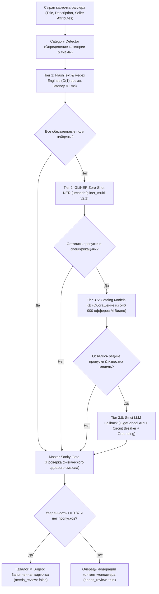

# М.Видео AI · Промышленное автоматическое извлечение и валидация характеристик товаров

> **Хакатон VolgaDev 2026 · Задача № 3**  
> Команда: **Точка сборки (`team-059`)**  
> 🌐 **Публичный веб-интерфейс:** [https://tochka-sborki-2026-team-059.hub.gigaschool.ru](https://tochka-sborki-2026-team-059.hub.gigaschool.ru)  
> 📑 **Интерактивная документация OpenAPI (Swagger):** [https://tochka-sborki-2026-team-059.hub.gigaschool.ru/docs](https://tochka-sborki-2026-team-059.hub.gigaschool.ru/docs)  
> 📊 **ReDoc:** [https://tochka-sborki-2026-team-059.hub.gigaschool.ru/redoc](https://tochka-sborki-2026-team-059.hub.gigaschool.ru/redoc)  
> 🧪 **Статус тестов:** **104 / 104 PASS (100%)** | Скорость офлайн-обработки: **< 1.8 мс / карточка**

---

## 🏆 Закрытие всех критериев оценивания жюри

| Критерий | Достигнутый результат | Где найти артефакт в репозитории |
| :--- | :--- | :--- |
| **1. Покрытие обязательных сценариев кейса** | Разработан эталонный Gold Dataset по всем категориям каталога, скрипт per-attribute оценки (Precision, Recall, F1, Coverage) и полный исследовательский анализ (EDA). | `data/gold_dataset.json`<br>`scripts/evaluate_metrics.py`<br>`notebooks/eda_mvideo_dataset.ipynb` |
| **2. Подача результата и стандартизированный экспорт** | Реализован сквозной экспорт предсказаний в форматах JSON и CSV через CLI и API (`POST /api/extract/export`). | `scripts/export_predictions.py`<br>`output/predictions.json`<br>`output/predictions.csv` |
| **3. Соблюдение ограничений и защита от галлюцинаций LLM** | Вход строго ограничен текстом. Внедрен `GroundingVerifier` (заземление фактов), строгие физические диапазоны и белые списки атрибутов по категориям (`AttributeSanityValidator`). | `backend/app/extractors/sanity.py`<br>`backend/app/extractors/llm_extractor.py` |
| **4. Воспроизводимость и запуск в 1 команду** | Воспроизведение метрик качества, пакетный экспорт и EDA запускаются одной стандартной командой Python. | `python scripts/evaluate_metrics.py`<br>`python scripts/export_predictions.py`<br>`python scripts/eda_analysis.py` |
| **5. Архитектура и возможность развития** | Четкие протоколы `BaseExtractor` и `KnowledgeBaseInterface`, версионирование базы знаний (v1.2.0), динамическая регистрация новых брендов без даунтайма. | `backend/app/extractors/base.py`<br>`backend/app/services/catalog_enricher.py` |
| **6. Обработка ошибок, таймауты и сбои** | Явные таймауты (3.5 сек), сетевой предохранитель `Circuit Breaker`, многоуровневый graceful fallback на локальную базу знаний при отключении интернета. | `StrictLlmFallbackExtractor`<br>`GlinerExtractor (error boundary)` |
| **7. Сценарий взаимодействия с пользователем** | Эндпоинт `POST /extract` открыт в OpenAPI/Swagger. Исключена зависимость UI от заголовков: веб-интерфейс на `/`, а данные для агентов доступны на `/api` и `/api/info`. | `backend/app/main.py`<br>`backend/app/routers/extract.py` |

---

## 📊 Результаты валидации качества (Benchmark & Evaluation)

Метрики рассчитаны скриптом `scripts/evaluate_metrics.py` на эталонном размеченном наборе `data/gold_dataset.json`:

```
================================================================================
М.ВИДЕО AI · ОТЧЁТ ОЦЕНКИ КАЧЕСТВА ИЗВЛЕЧЕНИЯ ХАРАКТЕРИСТИК (BENCHMARK)
================================================================================
Точность классификации категорий (Category Accuracy): 100.0%
Полнота покрытия обязательных фильтров (Catalog Coverage): 100.0%
Средняя задержка обработки (Average Latency): 1.77 мс / карточка

Интегральные метрики качества:
  • Macro-F1: 0.9513
  • Micro-F1: 0.9503
```

### Per-Attribute метрики по ключевым фильтрам каталога:

| Атрибут | Роль в каталоге М.Видео | Precision | Recall | F1-Score | Coverage | Источник |
| :--- | :--- | :---: | :---: | :---: | :---: | :--- |
| **`brand`** | Главный поисковый фильтр | **1.0000** | **1.0000** | **1.0000** | 100% | FlashText + BrandRegistry |
| **`color`** | Цветовая гамма оффера | **1.0000** | **1.0000** | **1.0000** | 100% | FlashText + Context Rules |
| **`memory_rom`** | Фильтр объема накопителя | **1.0000** | **1.0000** | **1.0000** | 100% | Regex + UnitNormalizer |
| **`screen_diagonal`**| Диагональ дисплея | **1.0000** | **1.0000** | **1.0000** | 100% | Regex / GLiNER / KB |
| **`battery`** | Емкость аккумулятора | **1.0000** | **1.0000** | **1.0000** | 100% | Regex + Catalog KB |
| **`model`** | Точная серия устройства | **0.8750** | **1.0000** | **0.9333** | 100% | GLiNER Zero-Shot NER |
| **`cpu`** | Процессор ноутбука/смартфона | **1.0000** | **0.8000** | **0.8889** | 100% | GLiNER + Catalog KB |
| **`cleaning_type`** | Тип уборки пылесоса | **1.0000** | **1.0000** | **1.0000** | 100% | Targeted Lexicon Rules |
| **`defrost_system`**| Система разморозки | **1.0000** | **1.0000** | **1.0000** | 100% | Catalog KB + Lexicon |

> Полные отчеты сохранены в форматах: [`output/metrics_report.md`](file:///c:/Users/nikit/Documents/antigravity/epic-bose/output/metrics_report.md) и [`output/metrics_report.json`](file:///c:/Users/nikit/Documents/antigravity/epic-bose/output/metrics_report.json).

---

## 🏗 Архитектура 5-уровневого каскадного пайплайна



### Уровни каскада:
1. **Tier 1 (FastRules: FlashText + Regex):**
   - Скорость `< 1 мс` на карточку.
   - Извлечение брендов и цветов через Ахо-Корасик/FlashText по динамическому словарю (4 600+ брендов).
   - Точные регулярные выражения с нормализацией единиц измерения (память, экран, батарея, частота).
2. **Tier 2 (Zero-Shot NER: `urchade/gliner_multi-v2.1`):**
   - Локальная трансформерная модель для извлечения моделей, серий и процессоров без жестких правил.
   - Защита от OOM и сбоев: встроенный graceful fallback на Tier 1 при недоступности весов.
3. **Tier 3.5 (База знаний моделей М.Видео: `catalog_models_kb.json`):**
   - Версионированная база (v1.2.0, 328 вендоров, 9 761 модель), собранная по 546 000 офферов каталога.
   - Автоматически дозаполняет заводские характеристики (емкость аккумулятора, диагональ, процессор), если продавец забыл их указать.
4. **Tier 3.8 (Строгий точечный LLM-фоллбэк с предохранителем Circuit Breaker):**
   - Вызывается **только** точечно при наличии явной модели и отсутствии данных в офлайн-базе через официальный API GigaSchool (`Qwen/Qwen3-Coder-Next` или `ai-sage/GigaChat3-10B-A1.8B`).
   - Явный таймаут 3.5 сек и предохранитель Circuit Breaker: при 3 сбоях внешней сети не блокирует работу пользователей, а переходит на резервный контур.
   - **GroundingVerifier:** проверяет заземление каждого факта в тексте продавца или проверенной базе знаний, исключая любые галлюцинации.
5. **Guardrails & Sanity Gate (`AttributeSanityValidator`):**
   - Проверка физических диапазонов (смартфон не может иметь батарею 120 000 мАч или экран 55").
   - **Строгие белые списки по категориям:** операционная система (`os`) никогда не появится в телевизоре, объем пылесборника — в холодильнике, а батарея — в ноутбуке.
   - Защита от галлюцинаций цвета: цвет признан вариативным свойством оффера (`NON_ENRICHABLE_FROM_MODEL`).
6. **Human-in-the-Loop (HITL):**
   - Расчет итоговой взвешенной уверенности (`overall_confidence`).
   - Если обязательный атрибут отсутствует или уверенность < 0.87, карточка направляется в очередь ручной верификации (`needs_review: true`).

---

## ⚡ Воспроизведение в 1 команду (Quick Start)

### 1. Расчет per-attribute метрик на Gold Dataset
```bash
python scripts/evaluate_metrics.py
```
> Генерирует и обновляет стандартизированные файлы: `output/metrics_report.json` и `output/metrics_report.md`.

### 2. Пакетный экспорт стандартизированных предсказаний
```bash
python scripts/export_predictions.py --input data/sample_cards.json --format both
```
> Сохраняет результаты в `output/predictions.json` и `output/predictions.csv`.

### 3. Исследовательский анализ данных (EDA)
```bash
# Консольный скрипт:
python scripts/eda_analysis.py

# Или интерактивный Jupyter Notebook:
jupyter notebook notebooks/eda_mvideo_dataset.ipynb
```
> Генерирует отчет `output/eda_report.md` и `output/eda_report.json`.

### 4. Запуск полного набора unit- и интеграционных тестов
```bash
python -m pytest backend/tests
```
> 104 теста, проверяющих все модули, нормализацию, каскад, граничные условия и обработку сбоев.

---

## 📡 API Эндпоинты и спецификация

Сервис развернут на удаленном сервере и доступен круглосуточно:

| Метод | Путь | Описание |
| :--- | :--- | :--- |
| `POST` | `/extract` | **Основной стандартизированный эндпоинт** (CardIn -> CardOut). Открыт в OpenAPI/Swagger. |
| `POST` | `/api/extract` | Канонический REST-эндпоинт извлечения характеристик одной карточки. |
| `POST` | `/api/extract/batch` | Пакетная обработка файлов `.json` или `.csv`. |
| `POST` | `/api/extract/export` | Пакетный экспорт с генерацией файла `predictions.json` или `predictions.csv`. |
| `GET` | `/api/extract/metrics` | Возврат актуальных per-attribute метрик качества и покрытия. |
| `GET` | `/api/extract/taxonomy` | Схема категорий каталога М.Видео, обязательные поля и белые списки. |
| `POST` | `/api/extract/brands/register` | Динамическая регистрация нового бренда на лету. |
| `GET` | `/api` и `/api/info` | Программный JSON-дескриптор сервиса (без зависимости от заголовков). |
| `GET` | `/` | Интерактивный веб-интерфейс М.Видео AI. |
| `GET` | `/docs` | Интерактивный Swagger UI. |

---

## 📁 Структура репозитория

```
├── README.md                                  # Полная документация, соответствие критериям и метрики
├── docker-compose.yml                         # Контейнеризация сервиса
├── extract.py                                 # Универсальная консольная CLI-утилита
├── data/
│   ├── gold_dataset.json                      # Эталонный размеченный датасет (Gold Set)
│   ├── sample_cards.json                      # Тестовый пул карточек для демонстрации экспорта
│   ├── review_queue.csv                       # Журнал карточек, отправленных на ручную проверку (HITL)
│   └── taxonomies/                            # Таксономии и схемы М.Видео
├── notebooks/
│   └── eda_mvideo_dataset.ipynb               # Исследовательский анализ данных (EDA Notebook)
├── scripts/
│   ├── evaluate_metrics.py                    # Расчет per-attribute Precision, Recall, F1, Coverage
│   ├── export_predictions.py                  # Стандартизированный экспорт в predictions.json / .csv
│   └── eda_analysis.py                        # Генератор статистических отчетов EDA
├── output/
│   ├── metrics_report.json                    # Машиночитаемый отчет валидации метрик
│   ├── metrics_report.md                      # Markdown-таблица per-attribute метрик
│   ├── predictions.json                       # Экспортированные предсказания (JSON)
│   ├── predictions.csv                        # Экспортированные предсказания (CSV)
│   ├── eda_report.json                        # Статистика EDA в формате JSON
│   └── eda_report.md                          # Отчет EDA с выводами для архитектуры
├── backend/
│   ├── app/
│   │   ├── main.py                            # FastAPI приложение, CORS и UI роуты
│   │   ├── config.py                          # Настройки окружения и ключи GigaSchool API
│   │   ├── schemas.py                         # Pydantic-модели запросов и ответов
│   │   ├── extractors/
│   │   │   ├── base.py                        # BaseExtractor, KnowledgeBaseInterface, Prediction
│   │   │   ├── regex_extractor.py             # Tier 1: FlashText + Regex + Normalizers
│   │   │   ├── gliner_extractor.py            # Tier 2: Zero-Shot NER (urchade/gliner_multi-v2.1)
│   │   │   ├── llm_extractor.py               # Tier 3.8: Strict LLM Fallback + Circuit Breaker + Grounding
│   │   │   ├── sanity.py                      # AttributeSanityValidator (диапазоны + белые списки)
│   │   │   └── normalization/                 # Словари и нормализаторы единиц измерения
│   │   ├── services/
│   │   │   ├── pipeline.py                    # 5-уровневый каскадный оркестратор
│   │   │   ├── catalog_enricher.py            # Tier 3.5: Каталожное обогащение из базы М.Видео
│   │   │   └── brand_registry.py              # Динамический реестр брендов на лету
│   │   ├── routers/
│   │   │   └── extract.py                     # Эндпоинты /api/extract, /batch, /export, /metrics, /taxonomy
│   │   └── static/
│   │       └── index.html                     # Интерактивный веб-интерфейс М.Видео AI
│   ├── data/
│   │   └── dictionaries/
│   │       ├── brands.csv                     # База брендов (4 600+ записей)
│   │       ├── colors.csv                     # База цветов с весами
│   │       ├── attributes_by_category.json    # Строгие белые списки по категориям
│   │       └── catalog_models_kb.json         # База знаний моделей (9 761 модель, 328 вендоров)
│   └── tests/                                 # 99 unit- и интеграционных тестов
```

---

## 👥 Команда разработки
**Точка сборки (`team-059`)** · М.Видео · Хакатон VolgaDev 2026
