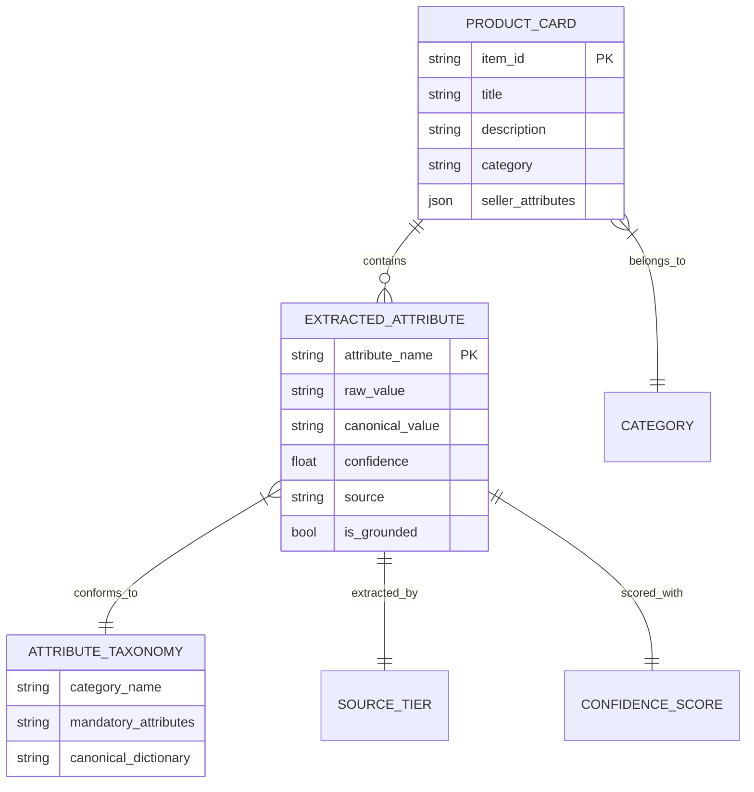

# Дерево Графов Проекта: E-Commerce · Автоматическое заполнение характеристик

Данный документ представляет структурированный **Граф Знаний (Knowledge Graph)** проекта: от бизнес-целей ритейлера и доменной модели до графа компонентов кода, проиндексированного в `codebase-memory-mcp`.

---

## 1. Мета-граф проекта (Архитектурное дерево)

```mermaid
graph TD
    Root["🎯 Кейс E-Commerce: Извлечение атрибутов товаров (Задача № 3)"]

    %% Ветки 1-го уровня
    Root --> Business["💼 Бизнес и Домен"]
    Root --> Pipeline["⚡ Трёхуровневый Каскад"]
    Root --> Normalization["📐 Нормализация и Валидация"]
    Root --> Guardrails["🛡️ Защита и Калибровка"]
    Root --> HITL["🔄 Human-in-the-Loop"]
    Root --> CodeGraph["🧬 Codebase Memory Graph (109 Nodes / 327 Edges)"]

    %% Ветка: Бизнес
    Business --> B1["Проблема: Хаос карточек селлеров"]
    Business --> B2["Цель: Полнота поисковых фильтров"]
    Business --> B3["Эффект: Рост CTR, Конверсии и GMV"]
    Business --> B4["Метрики: Per-attribute F1 + Coverage"]

    %% Ветка: Пайплайн
    Pipeline --> T1["Tier 1: Детерминированное ядро (FlashText + Regex)"]
    Pipeline --> T2["Tier 2: Zero-Shot NER (GLiNER Multi-v2.1)"]
    Pipeline --> T3["Tier 3: LLM Fallback (Точечный вызов для 5% хвоста)"]

    T1 --> T1_Specs["Бренды, базовые цвета, ROM/RAM, экраны, батареи (<1 мс, 0 ₽)"]
    T2 --> T2_Specs["Модели, процессоры, матрицы без дообучения (~50 карт/с)"]
    T3 --> T3_Specs["Сложный нарратив, редкие категории, строгий JSON-контракт"]

    %% Ветка: Нормализация
    Normalization --> N1["UnitNormalizer (1024 Гб → 1 ТБ, 6.7 дюйма → 6.7\")"]
    Normalization --> N2["CatalogCanonicalizer (RapidFuzz синонимы E-Commerce)"]
    Normalization --> N3["AttributeTypeValidator (Отсечение смысловых аномалий)"]

    %% Ветка: Защита
    Guardrails --> G1["Grounding Check (Span-Matching в исходном тексте)"]
    Guardrails --> G2["Confidence Calibration (Математические скоры спанов)"]
    Guardrails --> G3["Anti-Hallucination Guard (Блокировка недостоверных фактов)"]

    %% Ветка: HITL
    HITL --> H1["Триаж: Confidence < 0.75 или пропуск обязательного поля"]
    HITL --> H2["Очередь: review_queue.csv для оператора (3 сек/карточка)"]
    HITL --> H3["Active Learning: Разметка человека обогащает Tier 1 и Tier 3"]

    %% Ветка: Кодовый граф
    CodeGraph --> C_Entry["run_pipeline.main (Entry Point)"]
    CodeGraph --> C_Orch["src.pipeline.AttributeExtractionPipeline"]
    CodeGraph --> C_Models["src.models (ProductCard, ExtractedAttribute)"]
    CodeGraph --> C_Extr["src.extractors (Rules, GLiNER, LLM)"]
    CodeGraph --> C_Norm["src.normalizers (Units, Canonicalizer)"]
```

---

## 2. Граф потока данных карточки товара (Runtime Data Flow)

```mermaid
flowchart LR
    subgraph Input ["Входные данные"]
        Raw["Сырая карточка<br/>(title, desc, specs)"]
    end

    subgraph Tier1 ["Уровень 1: Быстрое ядро"]
        FT["FlashText (Ахо-Корасик)"]
        RG["Regex Matcher"]
        T1_Check{"Все обязательные<br/>поля закрыты?"}
    end

    subgraph Tier2 ["Уровень 2: Zero-Shot трансформер"]
        GL["GLiNER Multi-v2.1<br/>(Локально на ВМ)"]
        T2_Check{"Поля закрыты<br/>и Score >= 0.75?"}
    end

    subgraph Tier3 ["Уровень 3: LLM & Защита"]
        LLM["LLM Fallback (GigaChat)"]
        SpanGuard["Grounding Check<br/>(Спан есть в тексте?)"]
    end

    subgraph OutputStage ["Нормализация и Триаж"]
        Norm["RapidFuzz + UnitNormalizer"]
        ConfScore["Калибровка Confidence"]
        Decision{"Confidence >= 0.75<br/>и нет пропусков?"}
        Catalog[("Чистый каталог E-Commerce")]
        Review["Очередь модерации (HITL)"]
    end

    Raw --> FT & RG
    FT & RG --> T1_Check
    T1_Check -- "Да (70% карточек)" --> Norm
    T1_Check -- "Нет (30%)" --> GL
    GL --> T2_Check
    T2_Check -- "Да (25%)" --> Norm
    T2_Check -- "Нет (5%)" --> LLM
    LLM --> SpanGuard
    SpanGuard -- "Подтверждено" --> Norm
    SpanGuard -- "Галлюцинация" --> Review
    Norm --> ConfScore --> Decision
    Decision -- "Да" --> Catalog
    Decision -- "Сомнительно" --> Review
```



---

## 3. Топологический граф кодовой базы (из `codebase-memory-mcp`)

Результаты индексации репозитория `epic-bose`:
* **Узлов в графе:** 109 (Классы, Модули, Методы, Секции)
* **Ребер в графе:** 327 (DEFINES, CALLS, IMPORTS, USAGE, CONTAINS)
* **Слои архитектуры:**
  1. `entry`: `run_pipeline.py` (CLI интерфейс)
  2. `internal`: `src.pipeline` (Оркестратор каскада)
  3. `internal`: `src.extractors` (`FastRuleExtractor`, `GlinerZeroShotExtractor`, `LLMFallbackExtractor`)
  4. `core`: `src.normalizers` (`UnitNormalizer`, `CatalogCanonicalizer`)
  5. `core`: `src.validators` (`AttributeTypeValidator`)
  6. `core`: `src.models` (`ProductCard`, `ExtractedAttribute`, `CardExtractionResult`)

---

## 4. Граф Доменной Онтологии Товара (Product Domain Graph)



---

## 5. Запись в графовой памяти (ADR-001 в `codebase-memory-mcp`)

* **ADR-001:** `Трёхуровневый гибридный каскад для извлечения атрибутов товаров E-Commerce`
* **Статус:** `Accepted` (Зафиксировано в графе базы знаний)
* **Ключевой вывод:** Отказ от монолитного файнтюнинга в пользу каскада детерминированного ядра (FlashText/Regex) и Zero-Shot трансформера (GLiNER) со строгим аппаратным Grounding Check против галлюцинаций.
